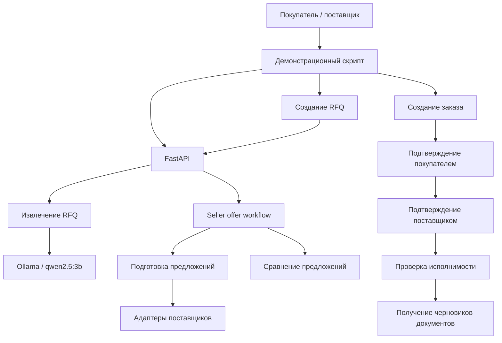
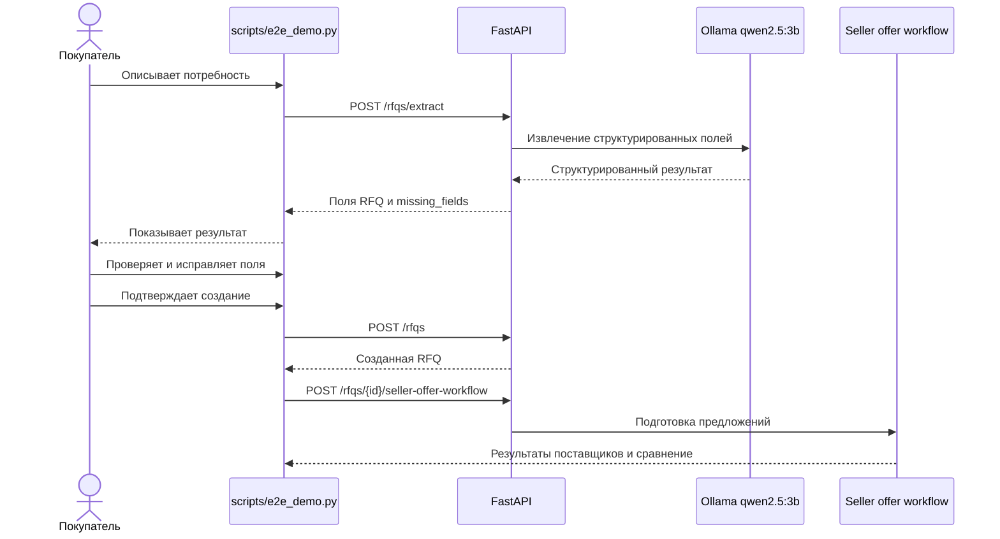

# Agent Execution Trace — RLT.Startup MVP

## 0. Суть проекта и демонстрационная история
 
RLT.Startup MVP демонстрирует B2B-маркетплейс, в котором программные компоненты, реализующие бизнес-роли покупателя, оркестратора и поставщиков, автоматизируют подготовку и согласование коммерческого предложения.
 
Покупатель формирует заявку на естественном языке. Локальная LLM преобразует текст в структурированные данные RFQ, которые покупатель может проверить и исправить.
 
Оркестратор запускает обработку заявки для нескольких поставщиков. Система проверяет каталоги, коммерческие политики и складские остатки, формирует допустимые предложения и сравнивает их.
 
После выбора предложения создаётся заказ. Его подтверждают две стороны: покупатель и поставщик. Перед подтверждением поставщика система повторно проверяет возможность исполнения заказа по актуальным данным поставщика.
 
После успешного двустороннего подтверждения платформа формирует три черновика документов.
 
**Главный принцип MVP:** рутинная обработка автоматизирована, но критические коммерческие решения остаются под контролем участников сделки. LLM используется для интерпретации текста, а коммерческие правила, полномочия и переходы состояний проверяются детерминированным кодом.
**Human-in-the-Loop (HITL)**

В MVP реализована модель Human-in-the-Loop: автоматизация не устраняет человека из процесса принятия критических коммерческих решений.

Контроль человека предусмотрен на нескольких уровнях:

- **Проверка данных RFQ:** покупатель проверяет и при необходимости исправляет результат извлечения локальной LLM.
- **Создание заявки:** RFQ создаётся только после явного подтверждения покупателем.
- **Выбор коммерческого предложения:** покупатель определяет, по какому предложению создаётся заказ. Автоматическое сравнение не означает автоматического выбора победителя.
- **Подтверждение заказа:** покупатель и поставщик отдельно подтверждают участие в сделке.
- **Контроль исполнения:** перед подтверждением поставщика система повторно проверяет коммерческие условия и доступность товара.

Таким образом, LLM и программные сервисы выполняют подготовительную и проверочную работу, а решения, создающие коммерческие обязательства, остаются за участниками сделки.

В MVP HITL реализован через явные действия участников и интерактивный демонстрационный сценарий. Отдельная графическая панель согласования не предусмотрена.

**Модель использования платформы и пользовательский интерфейс**

RLT.Startup MVP реализован как backend-платформа с API, а не как самостоятельное пользовательское приложение. Отдельный графический интерфейс покупателя или поставщика в текущую реализацию не входит.

Предполагаемая модель промышленного использования — интеграция с существующими корпоративными системами участников, прежде всего CRM и 1С. Такие системы остаются основными рабочими интерфейсами сотрудников, а RLT.Startup обеспечивает межорганизационное взаимодействие, координацию бизнес-процессов и автоматизацию операций с помощью программных компонентов и ИИ.

В демонстрационном MVP взаимодействие с API выполняется через скрипты E2E и интерактивный консольный сценарий. Это технический инструмент демонстрации, а не пользовательский интерфейс конечного продукта.

**Граница реализации:** готовые интеграции с CRM и 1С в текущем MVP не реализованы. Их подключение предусмотрено как направление дальнейшего развития через API и адаптеры.

**Статус проверки:** по результатам фактического запуска, сообщённым разработчиком, автоматизированные тесты проходят успешно, Ruff не обнаруживает замечаний, автоматический E2E-сценарий завершается успешно, интерактивный сценарий с локальной LLM также работает. Это подтверждает работоспособность проверенных сценариев в текущем окружении разработки. Результаты не следует автоматически распространять на ещё не реализованные интеграции с внешними CRM, 1С и промышленными системами поставщиков.

## 1. Цель документа
 
Документ отвечает на пять вопросов:
 
1. Как проходит демонстрационный сценарий от заявки покупателя до подтверждённого заказа?
2. Какие компоненты выполняют функции Buyer Agent, Orchestrator Agent и Seller Agent?
3. Где действительно используется локальная LLM, а где работает обычный Python-код?
4. Какие действия защищены проверками доступа, бизнес-правилами и подтверждением человека?
 
Основной принцип: **название бизнес-роли не означает, что в коде существует отдельный автономный ИИ-агент**. До обнаружения соответствующего компонента используем понятия «роль» и «функция, соответствующая роли».
 
## 2. Текущая карта архитектуры
 

 
Диаграмма отражает логическую последовательность, она не означает, что все этапы выполняются одним запросом или что генерация документов непосредственно вызывается из `supplier_confirm_order()`.
 
### Конфигурация приложения и демонстрационные данные
 
Основная точка входа FastAPI определена в `src/rlt_startup/api.py`. При создании приложения инициализируются in-memory репозитории заявок, предложений и заказов, журнал аудита `InMemoryAuditLog`, а также пустой реестр адаптеров поставщиков.
 
Доступ к этим компонентам предоставляется обработчикам API через функции-зависимости FastAPI, которые получают объекты из `request.app.state`.
 
Для демонстрационного запуска используется `src/rlt_startup/demo_api.py`. При импорте модуля вызывается `configure_demo_app()`, которая регистрирует адаптеры трёх демонстрационных поставщиков, создаваемые функцией `create_demo_adapters()` из `src/rlt_startup/demo.py`.
 
Демонстрационная конфигурация содержит три поставщика с товаром «Стальной лист» (единица измерения — кг, валюта — RUB). Для поставщиков A и B заданы остатки 250 и 180 кг, для поставщика C — 50 кг. Цены составляют соответственно 145,50, 160,00 и 135,00 RUB за кг.
 
Каждый поставщик получает собственный экземпляр `InMemoryCatalogPolicyAdapter` с каталогом, снимком складских остатков и коммерческой политикой. Снимки остатков при создании демонстрационных данных получают актуальную временную отметку.
 
Таким образом, базовая конфигурация приложения отделена от демонстрационного наполнения: `api.py` создаёт приложение и его основные зависимости, а `demo_api.py` подключает воспроизводимые данные поставщиков.
 
**Граница реализации:** демонстрационные каталоги, остатки и политики хранятся в памяти. Подключение реальных внешних систем учёта поставщиков не реализовано.
 
### Хранение заявок, предложений и заказов
 
Для хранения основных сущностей MVP используются три репозитория:
 
- `InMemoryRFQRepository` — заявки покупателя (RFQ);
- `InMemoryOfferRepository` — коммерческие предложения поставщиков (Offer);
- `InMemoryOrderRepository` — заказы (Order).
 
Репозитории реализованы в `src/rlt_startup/repositories/` и соответствуют отдельным протоколам `RFQRepository`, `OfferRepository` и `OrderRepository`.
 
Все три реализации хранят объекты в словарях в памяти процесса, используя UUID сущности в качестве ключа. При добавлении проверяется отсутствие записи с таким ID. Повторное добавление вызывает соответствующее исключение: `RFQAlreadyExistsError`, `OfferAlreadyExistsError` или `OrderAlreadyExistsError`.
 
Методы `get()` возвращают `None`, если запись не найдена. При сохранении и чтении используется `model_copy(deep=True)`: репозиторий не возвращает вызывающему коду прямую ссылку на хранящийся объект, а передаёт независимую глубокую копию.
 
Для заказов дополнительно предусмотрен метод `update()`. Он обновляет существующую запись с сохранением глубокой копии объекта и вызывает `KeyError`, если заказа с указанным ID нет.
 
**Тестовое покрытие:** `tests/test_repositories.py` проверяет независимость копий, защиту от повторного добавления и обработку неизвестных ID для Offer и Order Repository. В предоставленном файле отдельные тесты RFQ Repository отсутствуют.
 
**Граница реализации:** все три репозитория являются in-memory хранилищами. Сохранение данных между перезапусками приложения, транзакционность и работа с постоянной базой данных в этих реализациях не предусмотрены.
 
### Журнал аудита операций с заказами
 
Для регистрации событий жизненного цикла заказа используется `InMemoryAuditLog`, реализованный в `src/rlt_startup/services/audit_log.py`.
 
Событие аудита представлено неизменяемой структурой `AuditEvent` со следующими полями:
 
- `event_type` — тип события;
- `order_id` — идентификатор заказа;
- `occurred_at` — дата и время события с указанием часового пояса;
- `outcome` — результат (`success` или `blocked`);
- `reason_code` — необязательный код причины.
 
Журнал хранит события в списке в памяти процесса. Метод `append()` добавляет событие, а `list_events()` возвращает последовательность событий целиком или с фильтрацией по идентификатору заказа. Порядок регистрации событий сохраняется.
 
Создание событий выполняется через `make_audit_event()`. Если временная отметка не содержит часового пояса, фабрика и журнал отклоняют её с ошибкой `ValueError`.
 
В API регистрируются следующие события:
 
- `order_created` — создание заказа;
- `buyer_confirmed` — подтверждение покупателем;
- `supplier_confirmed` — подтверждение поставщиком;
- `order_rejected` — отказ от заказа;
- `policy_check_blocked` — блокировка подтверждения поставщиком при нарушении проверки исполнимости.
 
Для заблокированной проверки фиксируются `outcome="blocked"` и код причины `supplier_execution_check_failed`. Успешные операции регистрируются с результатом `success`.
 
**Тестовое покрытие:** `tests/test_audit_log.py` проверяет порядок добавления событий, фильтрацию по заказу, неизменяемость объекта события и отклонение временных отметок без часового пояса. `tests/test_api.py` проверяет регистрацию основных событий создания и подтверждения заказа, а также блокировку подтверждения поставщиком при недостаточном остатке.
 
**Границы реализации:** журнал существует только в памяти процесса; после перезапуска приложения записи не сохраняются. Отдельный API для просмотра журнала не реализован. Не предусмотрены криптографическая защита целостности, постоянное хранилище и идентификация конкретного пользователя или агента в полях события. Неизменяемость отдельного объекта `AuditEvent` не означает защищённость всего журнала от удаления или подмены записей.

### Аутентификация и разграничение доступа
 
Аутентификация реализована в `src/rlt_startup/services/authentication.py`.
 
Поддерживаются три роли:
- `buyer` — покупатель;
- `supplier` — поставщик;
- `orchestrator` — оркестратор процесса подбора предложений.
 
Идентичность содержит `subject_id`, `organization_id` и `role`. Демонстрационные учётные данные загружаются из JSON-переменной окружения `RLT_DEMO_CREDENTIALS`. Клиент передаёт токен в заголовке `Authorization: Bearer ...`.
 
Неизвестный или отсутствующий токен приводит к HTTP 401. Недостаточная роль — к HTTP 403. При проверке принадлежности заказа другой организации возвращается HTTP 404, чтобы не раскрывать наличие чужого заказа.
 
#### Правила доступа к операциям
 
| Операция | Разрешённая роль и ограничение |
|---|---|
| Создание RFQ | `buyer`; организация покупателя берётся из аутентифицированной идентичности, а не из запроса клиента |
| Получение RFQ | `buyer`, только для своей организации |
| Извлечение RFQ из текста | `buyer`; извлечение не создаёт заявку |
| Запуск процесса подбора предложений | `orchestrator`; в показанной реализации отдельной проверки принадлежности RFQ организации оркестратора нет |
| Создание заказа | `buyer`, только для RFQ своей организации; совместимость предложения с RFQ проверяется бизнес-логикой создания заказа |
| Подтверждение и отклонение заказа покупателем | `buyer`, только для организации-покупателя в заказе |
| Подтверждение и отклонение заказа поставщиком | `supplier`, только для организации-поставщика в заказе |
| Получение документов заказа | Только покупатель или поставщик, участвующий в заказе; оркестратор не имеет доступа |
 
Проверка роли выполняется функцией `require_role()`, проверка принадлежности стороны заказа — `require_order_party()` в `src/rlt_startup/api.py`.
 
#### Проверки
 
В `tests/test_authentication.py` проверены загрузка конфигурации, успешная аутентификация, отклонение отсутствующих и некорректных токенов, пустая конфигурация и некорректный JSON.
 
В `tests/test_documents.py` проверены ограничения доступа к документам для сторон заказа и посторонних пользователей.
 
Дополнительно в `tests/test_api.py` проверены ограничения доступа к RFQ и заказам: обязательность аутентификации, запрет операций для неподходящих ролей, изоляция RFQ между организациями покупателей, использование организации из токена при создании RFQ, а также ограничения создания, подтверждения и отклонения заказов. Проверены основные сценарии успешного взаимодействия покупателя и поставщика и недопустимые переходы состояния заказа.
 
В `tests/test_documents.py` проверены доступ покупателя и поставщика к документам собственного заказа, отказ посторонней организации и запрет доступа оркестратору.
 
**Ограничения демонстрационной реализации:** токены предназначены для демонстрационной конфигурации. Нет регистрации организаций и пользователей, выдачи и отзыва токенов, управления сессиями или интеграции с промышленной IAM-системой. Наличие проверок в обработчиках не означает, что исчерпывающе протестированы все комбинации ролей, организаций и операций.
 
### Извлечение данных RFQ с помощью локальной LLM
 
Реализация находится в `src/rlt_startup/services/rfq_extraction.py`. Функция `extract_rfq()` использует локально развёрнутую через Ollama языковую модель.
 
**Модель по умолчанию:** `qwen2.5:3b`.
 
**Размещение:** локальный HTTP API Ollama, адрес по умолчанию `http://127.0.0.1:11434/api/generate`. Модель и адрес могут быть переопределены переменными окружения `RLT_OLLAMA_MODEL` и `RLT_OLLAMA_URL`.
 
**Входные данные модели:** системная инструкция, исходный текст заявки покупателя и JSON Schema ожидаемого результата.
 
**Извлекаемые поля:** название товара, количество, единица измерения, максимальная цена за единицу, валюта и место доставки.
 
Для генерации используются `temperature=0`, `num_predict=192`, `num_thread=4`, `keep_alive=5m`. Тайм-аут HTTP-запроса составляет 45 секунд.
 
После получения ответа выполняются разбор JSON и валидация через Pydantic. Дополнительные поля запрещены, для строк и числовых значений заданы ограничения. Список `missing_fields` вычисляется приложением, а не принимается на доверии от модели.
 
Явно указанная в исходном тексте валюта определяется отдельной функцией `detect_explicit_currency()`. Если обнаружено ровно одно обозначение валюты, оно имеет приоритет над значением, возвращённым моделью. При неоднозначности автоматическая подстановка не выполняется.
 
Признак `ready_to_create_rfq` вычисляется приложением на основании наличия конкретного названия товара, количества, единицы измерения и корректной связи цены с валютой. Извлечение не создаёт RFQ и не изменяет данные репозитория.
 
Ошибки разделены на недоступность модели (`RFQModelUnavailableError`) и некорректный ответ модели (`RFQModelResponseError`). На уровне API им соответствуют HTTP 503 и HTTP 502; пустой входной текст приводит к HTTP 422.
 
**Ограничения:** структурная валидация не гарантирует смысловую точность извлечения. Результат модели не является подтверждённой заявкой и требует проверки покупателем. Отдельная защита от prompt injection в показанной реализации не подтверждена. Качество, задержка и потребление ресурсов модели должны оцениваться отдельными испытаниями.
 
#### Автоматизированная проверка извлечения RFQ
 
Покрытие сервиса тестами (`tests/test_rfq_extraction.py`) включает:
 
- проверку полного структурированного результата и признака `ready_to_create_rfq`;
- обработку отсутствующих обязательных полей;
- запрет готовности заявки при наличии цены без валюты;
- отклонение некорректного количества (ноль);
- отклонение слишком общего наименования товара;
- обработку недоступности Ollama;
- отклонение некорректного JSON в ответе модели;
- отказ от вызова модели для пустого текста.
 
API-тесты (`tests/test_rfq_extraction_api.py`) проверяют передачу исходного текста сервису, возврат валидированных полей, ответы с кодами 422, 502 и 503, а также требования аутентификации и роль покупателя.
 
**Характер тестирования:** обращения к Ollama в тестах подменяются. В сервисных тестах подменяется `urlopen`, в API-тестах — функция `extract_rfq`. Поэтому эти тесты проверяют программный контракт, валидацию и обработку ошибок, но не качество фактического извлечения локальной моделью.
 
**Ограничения:** тест оценки расхождения единиц измерения между исходным текстом и результатом модели пока не реализован (`test_quantity_unit_mismatch_is_not_silently_accepted` содержит `pass`). Отдельная оценка точности извлечения, задержки ответа и потребления ресурсов модели не представлена.
 
#### Интеграция извлечения RFQ в демонстрационный сценарий
 
В `scripts/e2e_demo.py` реализованы два режима демонстрации.
 
**Интерактивный режим (`--interactive`):**
 
1. Покупатель вводит описание потребности на естественном языке.
2. Скрипт вызывает `POST /rfqs/extract`.
3. API передаёт текст сервису извлечения с использованием локальной Ollama-модели, настроенной через `RLT_OLLAMA_MODEL` и `RLT_OLLAMA_URL`.
4. Скрипт показывает извлечённые поля и `missing_fields`.
5. Покупатель может подтвердить или исправить товар, количество, единицу измерения, максимальную цену, валюту и место доставки.
6. Перед созданием проверяются обязательные поля, конкретность наименования товара и наличие валюты при заданной цене.
7. RFQ создаётся только после явного подтверждения покупателем через `POST /rfqs`.
8. Затем запускается подготовка предложений трёх демонстрационных поставщиков и показываются результаты и сравнение.
9. Заказ автоматически не создаётся.
 
Таким образом, извлечение данных LLM встроено в интерактивный демонстрационный путь, а пользователь сохраняет контроль над содержанием заявки и подтверждает её создание.
 
**Автоматический режим:**
 
Использует заранее заданные данные RFQ и не вызывает `POST /rfqs/extract`. После создания заявки выполняет дальнейший сценарий подготовки предложений и обработки заказа.
 
**Граница реализации:** интерактивный режим демонстрирует извлечение и подготовку предложений, но не полный цикл заказа. Автоматический режим демонстрирует дальнейший процесс на фиксированных исходных данных, без участия LLM в извлечении RFQ.
 
## 3. Сквозной сценарий
 
### Этап 1. Покупатель формирует RFQ
 
**Подтверждено кодом:** `scripts/e2e_demo.py` вызывает `POST /rfqs/extract` в интерактивном режиме.
 
В `src/rlt_startup/api.py` обработчик `extract_rfq_from_text()`:
 
1. Проверяет роль `buyer`.
2. Вызывает `extract_rfq(payload.text)`.
3. Возвращает структурированный результат `RFQExtraction`.
4. Преобразует ошибки локальной модели в HTTP-ошибки.
 
Извлечение полей не создаёт заявку автоматически. После получения результата демонстрационный сценарий предлагает пользователю подтвердить или исправить значения, после чего отправляет `POST /rfqs`.

**Компонент, соответствующий Buyer Agent:** на текущем этапе — функция подготовки данных заявки, дополненная пользовательским взаимодействием. Отдельный класс или автономный Buyer Agent по результатам поиска не обнаружен.
 
### Этап 2. Локальная LLM извлекает поля заявки
 
**Разделение ответственности:**
 
| Операция | Исполнитель |
|---|---|
| Извлечение смысла из свободного текста | Локальная LLM |
| Проверка структуры ответа | Python / Pydantic |
| Проверка положительности количества и цены | Python / Pydantic |
| Определение отсутствующих полей | Python |
| Определение явно указанной валюты | Python |
| Решение, достаточно ли полей для создания RFQ | Python |
 
В коде предусмотрены отдельные ошибки недоступности модели и некорректного ответа. Обработчик API возвращает соответственно HTTP 503 и 502; пустой текст приводит к HTTP 422.
 
**Статус:** использование локальной LLM подтверждено кодом. Успешный запуск конкретной модели и фактические показатели качества/задержки здесь не подтверждены.
 
### Этап 3. Создание RFQ
 
Файл: `src/rlt_startup/api.py`.
 
Функция: `create_rfq()`.
 
Маршрут: `POST /rfqs`.
 
Последовательность:
 
1. Проверка роли `buyer`.
2. Присвоение `buyer_organization_id` на сервере из `identity`, а не доверие идентификатору организации из клиентского запроса.
3. Сохранение RFQ в `RFQRepository`.
4. Обработка конфликта идентификатора.
5. Возврат созданной RFQ.
 
Это детерминированная серверная логика, а не задача LLM.
 
В демонстрационном сценарии предусмотрен также путь создания RFQ без интерактивного извлечения.
 
### Этап 4. Оркестрация подготовки предложений
 
Файл: `src/rlt_startup/api.py`.
 
Маршрут: `POST /rfqs/{rfq_id}/seller-offer-workflow`.
 
Функция API: `execute_seller_offer_workflow()`.
 
Функция сервиса: `run_seller_offer_workflow()` из `services/seller_offer_workflow.py`.
 
Последовательность:
 
1. Проверка роли `orchestrator`.
2. Загрузка RFQ из репозитория.
3. Проверка отсутствия дублирующихся `supplier_ids`.
4. Запуск подготовки предложений поставщиков.
5. Сбор результатов по каждому поставщику.
6. Сравнение готовых предложений.
7. Сохранение готовых предложений в `OfferRepository`.
8. Возврат результатов подготовки и сравнения.
 
Это основной обнаруженный участок, соответствующий **Orchestrator Agent** по бизнес-функции: он организует обработку заявки для нескольких поставщиков и собирает результаты.
 
Однако реализация `run_seller_offer_workflow()` — обычная функция Python.

### Этап 5. Подготовка предложения поставщика
 
Файл: `src/rlt_startup/services/seller_offer_preparation.py`.
 
Основная функция: `prepare_seller_offer()`.
 
Для каждого поставщика выполняются проверки:
 
1. Наличие коммерческой политики.
2. Совпадение валюты RFQ и политики, если валюта RFQ задана.
3. Поиск товара в каталоге по нормализованному названию.
4. Точное совпадение единицы измерения.
5. Отсутствие неоднозначных совпадений.
6. Совпадение валюты товара с политикой поставщика.
7. Соблюдение предельной цены покупателя.
8. Наличие данных об остатках.
9. Актуальность временной отметки остатков.
10. Достаточность количества товара.
11. Соблюдение минимальной суммы заказа.
 
Если есть причины отказа, функция возвращает `ready=False`, `offer=None` и список причин. Если все проверки пройдены, формируется объект `Offer`.
 
**Компонент, соответствующий Seller Agent:** `prepare_seller_offer()` реализует ключевую бизнес-функцию подготовки предложения поставщика. Но по показанному коду это детерминированный сервис, а не автономный агент с LLM.
 
Называть его «ИИ-агентом» на основании только текущей реализации было бы неточно. Корректнее: **сервис подготовки предложения, реализующий бизнес-роль Seller Agent**.
 
#### Источник данных поставщика
 
**Статус: подтверждено кодом.**
 
Интерфейс `CatalogPolicyAdapter` из `services/catalog_policy.py` определяет доступ к трём видам данных:

- `list_catalog_items()` — каталог поставщика;
- `get_inventory()` — снимок остатков товара;
- `get_policy()` — коммерческая политика поставщика.

Текущая реализация `InMemoryCatalogPolicyAdapter` хранит эти данные в оперативной памяти и проверяет отсутствие дублирующихся идентификаторов товаров, снимков остатков и политик при инициализации.
 
Отделение интерфейса адаптера от его реализации позволяет в дальнейшем подключить внешнюю систему учёта поставщика, не переписывая бизнес-логику подготовки предложения и проверки исполнимости заказа.

**Ограничение:** в показанном коде реализовано хранение в памяти. Интеграция с реальной ERP, CRM или складской системой не подтверждена.

### Этап 6. Сравнение предложений

Файл: `src/rlt_startup/services/offer_comparison.py`.

Функции: `compare_offer()` и `compare_offers()`.

Перед расчётом выполняется `validate_offer_against_rfq()` из `services/offer_validation.py`.

Проверяются:

- соответствие RFQ;
- принадлежность позиций заявке;
- отсутствие повторяющихся позиций;
- отсутствие неизвестных идентификаторов позиций;
- срок действия предложения;
- наличие всех позиций;
- совпадение единиц измерения;
- достаточность количества.

Для допустимого предложения рассчитывается общая стоимость. Результаты сортируются по валюте, допустимости и стоимости.

Это детерминированная бизнес-логика.

**Важное ограничение:** сравнение учитывает валюту как ключ группировки, но пересчёт между валютами отсутствует. Сравнение сумм из разных валют не следует трактовать как единый ценовой рейтинг.

### Этап 7. Создание заказа

Файл: `src/rlt_startup/api.py`.

Маршрут: `POST /rfqs/{rfq_id}/orders`.

Функция API: `create_order()`.

Функция бизнес-логики: `create_order_from_offer()` из `services/order_workflow.py`.

Последовательность:

1. Проверка роли `buyer`.
2. Загрузка RFQ и проверка принадлежности организации покупателя.
3. Загрузка выбранного предложения.
4. Проверка соответствия предложения заявке.
5. Проверка срока действия предложения.
6. Проверка валюты, единиц измерения, количества и предельной цены.
7. Расчёт общей суммы.
8. Создание заказа со статусом ожидания подтверждения покупателя.
9. Сохранение заказа.
10. Запись события `order_created` в аудит.

Создание заказа не означает, что сделка окончательно подтверждена. В реализации предусмотрены два последовательных подтверждения.

### Этап 8. Подтверждение покупателем

Маршрут: `POST /orders/{order_id}/buyer-confirmation`.

Функции: `confirm_order_by_buyer()` в API и `buyer_confirm_order()` в `services/order_workflow.py`.

Перед изменением статуса проверяется, что:

- заказ существует;
- вызывающая сторона имеет право действовать от имени покупателя;
- текущий статус допускает подтверждение покупателем;
- предложение ещё действительно.

После этого заказ переводится в `pending_supplier_confirmation`, обновляется в репозитории и регистрируется событие `buyer_confirmed`.

Это явное действие участника сделки. В показанном сценарии покупатель не заменён автономным решением LLM.

### Этап 9. Проверка исполнимости заказа поставщиком

**Статус: подтверждено кодом.**

Перед окончательным подтверждением поставщика функция
`supplier_confirm_order()` вызывает `check_order_executability()`.

Проверка выполняется детерминированно, средствами Python, без вызова LLM.

Проверяются:

1. Не истёк ли срок действия предложения.
2. Существует ли коммерческая политика поставщика.
3. Совпадает ли валюта политики с валютой заказа.
4. Не ниже ли сумма заказа минимальной суммы поставщика.
5. Присутствуют ли товары в каталоге поставщика.
6. Не неоднозначен ли идентификатор товара в каталоге.
7. Принадлежит ли товар нужному поставщику.
8. Совпадают ли единицы измерения.
9. Совпадает ли валюта товара с валютой заказа.
10. Достаточен ли актуальный остаток для исполнения заказа.

Для проверки остатков используются следующие правила:

- отсутствующие данные об остатке блокируют подтверждение;
- неизвестное доступное количество блокирует подтверждение;
- снимок остатков из будущего блокирует подтверждение;
- снимок старше допустимого срока блокирует подтверждение;
- недостаточное количество товара блокирует подтверждение.

Допустимый возраст снимка остатков по умолчанию составляет 24 часа.

Результат `SupplierExecutionCheck` содержит:
- `allowed` — разрешено ли исполнение;
- `reasons` — список причин отказа;
- `checked_at` — время проверки.

Если проверка не пройдена, `supplier_confirm_order()` возбуждает
`OrderPolicyViolation`, и заказ не должен переходить в состояние
`order_confirmed`.

Цена из текущего каталога не заменяет зафиксированную цену заказа.
При этом актуальность цены отдельно от остальных условий не проверяется:
этот механизм предназначен прежде всего для проверки возможности исполнения
заказа по уже согласованным условиям.

### Этап 10. Подтверждение поставщиком

Маршрут: `POST /orders/{order_id}/supplier-confirmation`.

Функции: `confirm_order_by_supplier()` в API и `supplier_confirm_order()` в `services/order_workflow.py`.

Перед подтверждением:

1. API загружает заказ и возвращает HTTP 404, если он не найден.
2. Проверяет, что запрос выполняет сторона-поставщик.
3. Получает адаптер соответствующего поставщика. Если адаптер не настроен, возвращает HTTP 422.
4. Вызывает `supplier_confirm_order()`.
5. Бизнес-функция проверяет статус заказа и срок действия предложения.
6. Вызывает `check_order_executability()` и проверяет результат.
7. При успешной проверке возвращает заказ в состоянии `CONFIRMED`.
8. API сохраняет обновлённый заказ и регистрирует событие `supplier_confirmed`.

**Обработка отказов:**

- При `OrderPolicyViolation` API регистрирует событие `policy_check_blocked` с кодом причины `supplier_execution_check_failed` и возвращает HTTP 422 с описанием ошибки.
- При `OrderWorkflowError` API возвращает HTTP 422 с описанием ошибки, но в этой ветви не регистрирует событие `policy_check_blocked`.
- При отказе по политике API не вызывает `repository.update()`, поэтому изменённый заказ не сохраняется.
- Событие `supplier_confirmed` записывается только после успешного подтверждения и обновления репозитория.

**Статус: подтверждено кодом.** В тестах `tests/test_api.py` также проверяется отсутствие `supplier_confirmed` и отсутствие отметки времени подтверждения поставщиком при блокировке.

**Ограничение аудита:** журнал содержит общий `reason_code`, а подробная причина отказа передаётся клиенту в HTTP-ответе. Наличие подробной причины непосредственно в событии аудита не подтверждено.

### Этап 11. Формирование документов

Маршрут: `GET /orders/{order_id}/documents`.

Функция API: `get_order_documents()` в `src/rlt_startup/api.py`.

Функция генерации: `generate_document_drafts()` из `services/document_generation.py`.

После успешного подтверждения заказа обеими сторонами платформа позволяет получить комплект из трёх черновиков:

1. `commercial_offer` — коммерческое предложение;
2. `order` — документ заказа;
3. `shipping_specification` — отгрузочная спецификация.

**Условия формирования:**

- заказ должен существовать;
- статус заказа должен быть `CONFIRMED`;
- должны присутствовать отметки времени подтверждения покупателем и поставщиком;
- запрос должен поступать от покупателя или поставщика, участвующего в соответствующей сделке.

Для посторонних организаций API возвращает HTTP 404, для роли оркестратора — HTTP 403, для неаутентифицированного клиента — HTTP 401. Для неподтверждённого заказа возвращается HTTP 422.

Генерация выполняется детерминированным Python-кодом на основе структурированных данных заказа. LLM не используется.

Документы получают статус `draft`. Генерация не означает юридического утверждения, подписания или отправки документов контрагенту.

**Тестовое покрытие:** `tests/test_documents.py` проверяет формирование трёх документов, расчёт сумм, допустимые статусы заказа, отсутствие изменения исходного заказа, API-ответы и разграничение доступа между ролями и организациями.

**Ограничения:** подтверждённая реализация формирует объекты черновиков и возвращает их через API. Файлового хранилища, экспорта в PDF/DOCX, электронной подписи и интеграции с ЭДО нет.

## 4. Таблица взаимодействия ролей

| Этап | Бизнес-роль | Реальный компонент | Тип логики |
|---|---|---|---|
| Подготовка заявки из текста | Buyer Agent | `extract_rfq()` | Локальная LLM + Python-валидация |
| Исправление полей заявки | Покупатель | `scripts/e2e_demo.py` | Пользовательское взаимодействие |
| Создание RFQ | Buyer / платформа | `create_rfq()` | Python, проверка доступа, репозиторий |
| Запуск подготовки предложений | Orchestrator Agent | `execute_seller_offer_workflow()` | Python, проверка доступа |
| Координация поставщиков | Orchestrator Agent | `run_seller_offer_workflow()` | Python |
| Подготовка предложения | Seller Agent | `prepare_seller_offer()` | Python, каталог, политика, остатки |
| Сравнение предложений | Orchestrator / платформа | `compare_offers()` | Python |
| Создание заказа | Покупатель / платформа | `create_order_from_offer()` | Python, бизнес-валидация |
| Подтверждение заказа покупателем | Покупатель | `buyer_confirm_order()` | Явное действие, Python |
| Проверка и подтверждение поставщиком | Поставщик / платформа | `supplier_confirm_order()` | Явное действие + Python-проверки |
| Подготовка документов | Платформа | get_order_documents() → generate_document_drafts() | Python, проверка статуса и доступа, формирование черновиков |

## 5. Локальная LLM: текущая граница применения

Технический путь:

```text
POST /rfqs/extract
  -> extract_rfq()
    -> HTTP POST к Ollama
      -> разбор JSON
        -> Pydantic-валидация
          -> вычисление missing_fields
            -> RFQExtraction
```

## 6. Контроль доступа, доверие и аудит

В предоставленном коде видны следующие механизмы:

- Ролевой доступ к маршрутам через `require_role()`.
- Проверка принадлежности RFQ организации покупателя.
- Определение организации покупателя сервером из `identity`.
- Проверка прав участника перед подтверждением или отказом по заказу.
- Проверка коммерческой политики поставщика.
- Проверка свежести и достаточности складских остатков.
- Проверка срока действия предложения.
- Раздельное подтверждение заказа покупателем и поставщиком.
- Аудит создания, подтверждения и блокировки заказа.

## 7. E2E-сценарий демонстрации

### Путь заявки


### Сквозной сценарий создания и подтверждения заказа

Автоматический режим `scripts/e2e_demo.py` демонстрирует последовательность от создания RFQ до получения комплекта документов.

1. Создаётся RFQ с заранее заданными параметрами.
2. Запускается подготовка предложений трёх демонстрационных поставщиков.
3. Скрипт проверяет ожидаемый результат: предложения A и B готовы, предложение C не подготовлено.
4. Создаётся заказ по предложению A.
5. Проверяется, что новый заказ находится в статусе `pending_buyer_confirmation`.
6. До подтверждения обеими сторонами запрашиваются документы. Ожидаемый ответ API — HTTP 422.
7. Покупатель подтверждает заказ. Статус меняется на `pending_supplier_confirmation`.
8. Поставщик подтверждает заказ. Сервер повторно проверяет политику и складские остатки через демонстрационный адаптер. При успешной проверке заказ получает статус `order_confirmed`.
9. API возвращает три черновика документов: `commercial_offer`, `order`, `shipping_specification`. Скрипт проверяет их типы и статус `draft`.
10. Дополнительно проверяется, что заказ создан по предложению A.

Успешное завершение сценария сопровождается сообщением `E2E PASS`.

**Граница демонстрации:** автоматический режим использует заранее заданную RFQ и не проверяет извлечение данных локальной LLM. Интерактивный режим демонстрирует отдельный путь с извлечением RFQ и подготовкой предложений, но не создаёт заказ.
